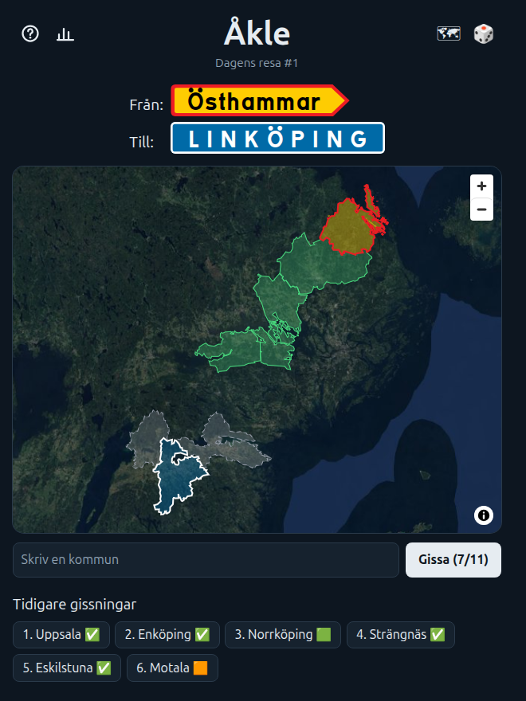

# Åkle

Travel across Sweden one kommun at a time. A new trip every day at **[akle.grehn.net](https://akle.grehn.net)**.



## How to play

Every day, everyone gets the same start and destination kommun. Name the kommuner that connect them, one neighbor after another, and get from start to destination in as few guesses as possible.

Each guess shows on the map and gets a mark:

- ✅ on a shortest route and connected to the start
- 🟩 on a shortest route, but not yet connected to the start
- 🟧 close to a shortest route
- 🟥 far from a shortest route

How many guesses you get depends on how long the shortest route is. Finish with more guesses than the shortest route needs and your result shows the difference, like **+2**. Finish with nothing but ✅ and no hints, and it's **Perfekt**.

Stuck? There are three hints (_ledtrådar_): the outline of the next kommun on a shortest route, the outlines of every kommun, and then their initials. Hints don't cost guesses, but a game with hints can't be Perfekt.

Win on consecutive days to build a streak, and share a spoiler-free result with your friends. A new trip starts at midnight, your local time.

## What counts as a neighbor?

Two kommuner are neighbors when you could get from one to the other:

- **over land**, by a shared border, even if they only touch at a single point;
- **over a bridge or through a tunnel**, by a public road, path or railway.

Borders along a river count too, as long as they are at least a kilometer long. Tiny islets, short river borders and detached bits of a kommun (exclaves) don't.

Gotland and Öckerö have no bridge or land border, so they are linked by ferry. They are dead ends: a route can start or end there, but never pass through.

Every borderline case was checked by hand. Think two kommuner should (or shouldn't) be neighbors? Use the _Rapportera fel_ link in the game.

## Behind the scenes

- Each day's trip is picked in advance from a reviewed schedule, so it's the same for everyone and never changes.
- The kommun borders come from [OpenStreetMap](https://www.openstreetmap.org/), and the neighbors are computed from them.
- No account, no tracking: your stats and streak stay in your browser.

## Inspiration and credits

Åkle is inspired by [Travle](https://travle.earth/), which does the same with countries, and [Kommunle](https://kommunle.se/), which put Swedish kommuner on a satellite map.

- Satellite imagery: [EOxCloudless https://cloudless.eox.at](https://cloudless.eox.at) by [EOX IT Services GmbH](https://eox.at) (Contains modified Copernicus Sentinel data 2016 & 2017), licensed under [CC BY 4.0](https://creativecommons.org/licenses/by/4.0/).
- Road-sign lettering: Tratex, the Swedish road-sign typeface, from [Transportstyrelsen](https://www.transportstyrelsen.se/).
- Kommun borders and neighbors: © [OpenStreetMap contributors](https://www.openstreetmap.org/copyright), licensed under the [ODbL](https://opendatacommons.org/licenses/odbl/1-0/).

## For developers

You need [Bun](https://bun.sh/) (the version in `package.json`, currently 1.3) and [Node.js](https://nodejs.org/) (the version in `.node-version`, currently 24). Then:

```sh
bun install
bun run dev
```

Deployment, CI and rollback are in [docs/development.md](docs/development.md). The game's vocabulary is in [GLOSSARY.md](GLOSSARY.md), and the design decisions in [docs/adr/](docs/adr/).
